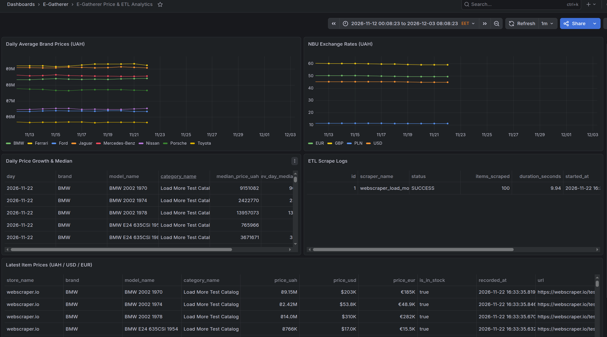

# «Проєктування та реалізація бази даних інформаційної системи автоматизованого збору, зберігання та аналізу даних із вебресурсів»


-4169E1?style=flat-square&logo=postgresql&logoColor=white)

-2EAD33?style=flat-square&logo=playwright&logoColor=white)


**E-Gatherer** — асинхронна ETL-система для автоматизованого збору цін із вебресурсів та курсів валют НБУ, збереження часових рядів (time-series) у PostgreSQL і побудови аналітичних представлень (views) для візуалізації в Grafana.

Проєкт оптимізований під апаратні обмеження цільового сервера (4 ГБ RAM, 2-ядерний CPU, 5400 RPM HDD): використовує `httpx` для легких JSON API, headless **Playwright (Firefox/Gecko)** лише там, де потрібен рендеринг JS, та `@dataclass(slots=True, frozen=True)` для зменшення витрат пам'яті.

> **Подяка:** Висловлюю щиру подяку **Дмитру Михайловичу**, викладачу дисципліни «Бази даних» у КАІ, за менторство, підтримку та підказку ідей для розвитку проєкту.

---

## Архітектура бази даних (PostgreSQL 17)

Ініціалізація розширення `pg_trgm` та ролей виконується в [`database/01-init.sql`](database/01-init.sql) і [`database/02-roles.sh`](database/02-roles.sh), а схема таблиць та індексів описана у [`src/db/models.py`](src/db/models.py):

- **`catalog.stores`** — перелік відстежуваних магазинів (`name`, `base_url`, `is_active`).
- **`catalog.categories`** — ієрархія категорій товарів (`name`, `slug`, `parent_id`).
- **`catalog.products`** — еталонні товари (`brand`, `model_name`, `specs JSONB`) із GIN-індексом `ix_products_model_name_trgm` (`gin_trgm_ops`) для нечіткого пошуку `pg_trgm`.
- **`catalog.store_products`** — прив'язка пропозицій магазину до еталонного товару (`store_id`, `product_id`, `external_id`, `url`, `is_in_stock`).
- **`pricing.price_history`** — історія цін у UAH та обчисленому еквіваленті USD (`recorded_at DESC` індекс).
- **`pricing.exchange_rates`** — щоденні офіційні курси валют НБУ.
- **`etl.scrape_logs`** — журнал запусків колекторів (`SUCCESS` / `FAILED`, кількість елементів, час виконання).

### Аналітичні Views ([`src/db/sql_views.py`](src/db/sql_views.py))

- `analytics.v_daily_price_aggregates` — денні агрегати цін (`MIN`, `AVG`, `MAX`, медіана через `percentile_cont(0.5)`).
- `analytics.v_price_growth` — відстеження щоденної динаміки цін через віконну функцію `LAG()`.
- `analytics.v_product_match_bare_sql` — базове зіставлення назв товарів через `LIKE '%' || ... || '%'` (повільне сканування без індексу).
- `analytics.v_product_match_trgm` — нечітке зіставлення назв через `pg_trgm` (`%`, `similarity()`, `word_similarity()`).
- `analytics.v_scrape_logs` — журнал запусків ETL (`etl.scrape_logs`) із тривалістю виконання `duration_seconds` для Grafana.
- `analytics.v_exchange_rates` — офіційні курси валют НБУ (`pricing.exchange_rates`) у схемі `analytics`.
- `analytics.v_latest_item_prices` — актуальні ціни товарів за кожним магазином у UAH, USD та EUR.

---

## Структура проєкту

```text
E-gatherer/
├── database/
│   ├── 01-init.sql            # Ініціалізація розширення pg_trgm
│   ├── 02-roles.sh            # Least-privilege ролі (etl_worker, grafana_reader) та схеми
│   ├── .env.example           # Шаблон змінних середовища
│   └── README.md              # Інструкції з БД, перевірки контейнерів і ручного запуску
├── grafana/
│   ├── config/
│   │   ├── datasources.yml    # Автоконфігурація PostgreSQL джерела (grafana_reader)
│   │   └── dashboards.yml     # Провайдер дашбордів
│   └── dashboards/
│       └── egatherer.json     # Дашборд цін, курсів НБУ та ETL-логів
├── imgs/
│   └── grafana-example.png    # Скриншот прикладу роботи дашборду Grafana
├── scripts/
│   ├── benchmark_trgm.py      # Бенчмарк bare SQL vs pg_trgm на реальній БД
│   ├── benchmark_trgm_large.py # Бенчмарк на 100 000 синтетичних рядків
│   └── seed_history.py        # Заповнення 30d історії курсів НБУ та цін
├── src/
│   ├── collectors/
│   │   ├── api/               # Асинхронні API-колектори (currency.py, brain.py)
│   │   ├── websites/          # Playwright (Firefox/Gecko) вебскрапери (playwright_base.py, webscraper_io.py)
│   │   ├── base.py            # Базовий контракт BaseParser (fetch -> parse -> save + логи)
│   │   └── schemas.py         # Імутабельні DTO (slots=True, frozen=True)
│   ├── db/                    # SQLAlchemy 2.0 моделі, підключення, репозиторій, SQL views
│   ├── logger_config.py       # Ротовані логи (logs/app.log) + stdout
│   ├── main.py                # Точка входу ETL runner (--once / планувальник)
│   └── scheduler.py           # Щоденний випадковий планувальник (01:00–04:00 Europe/Kyiv)
├── tests/
│   ├── test_playwright_base.py # Юніт-тести оптимізацій Playwright
│   ├── test_scheduler.py      # Юніт-тести планувальника та ізоляції помилок
│   └── test_seed_history.py   # Юніт-тести історичного заповнення
├── todos/                     # Архітектурний план і нотатки проєкту
├── .dockerignore              # Виключення секретів та зайвих файлів із Docker-білду
├── docker-compose.yml         # Стек сервісів (db, scraper, grafana)
├── Dockerfile                 # Образ застосунку (Python 3.14 + Playwright Firefox)
├── Makefile                   # Команди налаштування, збірки, запуску, сиду та тестів
├── pyproject.toml             # Залежності та метадані Python (uv)
└── requirements.txt           # Зафіксовані залежності для Docker pip install
```

---

## Приклад роботи системи (Grafana + Docker Compose)

Запуск повного стеку (`db`, `scraper`, `grafana`) та історичного заповнення за 30 днів:

```bash
make docker-build
make up
make seed-container
```

Після запуску дашборд доступний за адресою `http://127.0.0.1:3000`:



---

## Швидкий старт (локально)

### 1. Встановлення залежностей та браузера Firefox для Playwright

```bash
make setup
```

Для чистої Linux-системи (разом із системними бібліотеками для Firefox):

```bash
make setup-deps
```

### 2. Запуск колекторів та бенчмарку

```bash
# Тестовий запит курсу USD з API НБУ
make currency

# Dry-run Playwright (Firefox/Gecko) скрапера для webscraper.io (без запису в БД)
make scrape

# Запуск скрапера зі збереженням у PostgreSQL
make scrape-save

# Порівняння EXPLAIN (ANALYZE, BUFFERS) між bare SQL (ILIKE/LIKE) та pg_trgm
make bench

# Масштабний тест на 100 000 рядків (тимчасові таблиці, без засмічення БД)
make bench-large
```

---

## Порівняння швидкості та точності: Bare SQL vs `pg_trgm`

Заміри виконано на `94` товарах у `catalog.products` (`uv run python -m scripts.benchmark_trgm --queries Mercedes Mercdes Ferari Toyta`, поріг `% >= 0.2`):

| Тест / Запит | Bare SQL (`ILIKE` / `LIKE`) | `pg_trgm` (`% >= 0.2` / `similarity`) | Bare SQL (хіти) | `pg_trgm` (хіти) |
| :--- | :---: | :---: | :---: | :---: |
| Пошук `'Mercedes'` (точний) | `0.108 ms` *(20.62 ms клієнт)* | `0.427 ms` *(8.46 ms клієнт)* | `10` | `10` |
| Пошук `'Mercdes'` (опечатка) | `0.154 ms` *(1.91 ms клієнт)* | `0.367 ms` *(3.02 ms клієнт)* | `0` | **`7`** *(score `0.207–0.250`)* |
| Пошук `'Ferari'` (опечатка) | `0.119 ms` *(1.56 ms клієнт)* | `0.426 ms` *(2.88 ms клієнт)* | `0` | **`13`** *(score `0.353`)* |
| Пошук `'Toyta'` (коротка опечатка) | `0.139 ms` *(1.52 ms клієнт)* | `0.327 ms` *(3.65 ms клієнт)* | `0` | `0` |
| View `v_product_match_*` (`LIMIT 50`) | `1.597 ms` *(4.73 ms клієнт, `11` buffers)* | `27.256 ms` *(30.19 ms клієнт, `191` buffers)* | `50` *(без сортування)* | `50` *(топ із `529` пар за `similarity`)* |

- **Чому на `94` рядках `ILIKE`/`LIKE` швидший (обидва роблять `Seq Scan`):** уся таблиця займає `1` сторінку пам'яті (`shared hit=1`), тому обидва запити читають ту саму сторінку, а різницю створює навантаження на CPU:
  - `ILIKE` виконує просте посимвольне порівняння підрядка без сортування й зупиняється одразу після набору `LIMIT`.
  - `pg_trgm` для кожного рядка будує триграми (3-символьні фрагменти), рахує їх перетин (`|A ∩ B| / |A ∪ B|`) і запускає `Sort` за `similarity()`.
  - У view `v_product_match_bare_sql` немає `ORDER BY`, тому `LIMIT 50` зупиняється вже на перших `5` рядках зовнішньої таблиці (`actual rows=5`), тоді як `v_product_match_trgm` перевіряє всі `94` рядки, знаходить `529` пар і сортує їх.
- **Точність проти швидкості:** `pg_trgm` знаходить опечатки (`Mercdes`, `Ferari`), де `ILIKE` дає `0`. Для коротких токенів на кшталт `Toyta` у довгих назвах краще підходить `word_similarity()` або нижчий поріг.
- **Висновок:** на малих обсягах даних (десятки–кілька тисяч рядків) `pg_trgm` **не швидший** за звичайні `ILIKE`/`LIKE`, але забезпечує значно вищу **точність і повноту (fuzzy recall)** для опечаток і зіставлення різних назв товарів. Перевага `pg_trgm` у швидкодії розкривається на великих каталогах (десятки тисяч+ рядків), коли `GIN (gin_trgm_ops)` перемикає план із `Seq Scan` на `Bitmap Index Scan` і пропускає ~99% сторінок таблиці.

### Замір на великій БД (`100 000` рядків, `make bench-large`)

Тимчасові таблиці `bench_bare` (звичайний `B-Tree`) та `bench_trgm` (`GIN gin_trgm_ops`), поріг `% >= 0.2`:

| Тест / Запит | Bare SQL `ILIKE` (`Seq Scan`) | `pg_trgm` (`Bitmap Index Scan` + `GIN`) | Прискорення | Хіти (`Bare` / `pg_trgm`) |
| :--- | :---: | :---: | :---: | :---: |
| Пошук `'Mercedes'` (точний) | `12.247 ms` *(стоп на `19 980` рядках)* | **`4.705 ms`** *(20/100)* | **2.6x** | `20` / `20` |
| Пошук `'Mercdes'` (опечатка) | `57.012 ms` *(всі `100 000` рядків)* | **`2.910 ms`** | **19.6x** | `0` / `0` *(при `>= 0.2`)* |
| Пошук `'Ferari'` (опечатка) | `55.077 ms` *(всі `100 000` рядків)* | **`2.918 ms`** | **18.9x** | `0` / **`20`** |
| Пошук `'RTX4070Ti'` (точний) | `11.078 ms` *(стоп на `18 982` рядках)* | **`1.334 ms`** | **8.3x** | `20` / `20` |
| Batch-матчинг (`25` назв × `100 000`) | `1787.541 ms` *(`2.5 млн` перевірок)* | **`136.457 ms`** | **13.1x** | `0` / **`50`** *(з `2500` пар)* |

- **Переломний момент підтверджено практично:** якщо на `94` рядках `ILIKE` перемагав за рахунок 1 сторінки без індексу, то на `100 000` рядків планувальник вмикає `Bitmap Index Scan on ix_bench_trgm_gin` — `pg_trgm` стає швидшим у **2.6–19.6 раза** на одиночному пошуку та в **13.1 раза** на пакетному зіставленні (знаходячи опечатки, де `ILIKE` повертає `0`).
- **Методологічне зауваження (`EXPLAIN ANALYZE` і різні задачі):**
  - Використання індексу перевірено через `EXPLAIN (ANALYZE, BUFFERS)`: на `94` рядках планувальник свідомо обирає `Seq Scan`, а на `100 000` рядків — `Bitmap Index Scan on ix_bench_trgm_gin`.
  - `LIKE`/`ILIKE` (точний пошук підрядка) та `pg_trgm` `%`/`similarity()` (нечітке зіставлення з ранжуванням) вирішують **різні задачі**; для чистого порівняння швидкодії на одній і тій самій задачі `scripts/benchmark_trgm_large.py` також порівнює `ILIKE` без індексу проти `ILIKE` з `GIN (gin_trgm_ops)`.

### Простими словами: чому `LIKE` / `ILIKE` повільний на великій БД

Уявіть базу даних як книгу:

1. **Звичайний індекс (B-Tree) — це алфавітний словник (А–Я):**
   - Пошук за початком слова (`LIKE 'Merc%'`) миттєвий — одразу відкриваємо літеру **M**.
   - Пошук всередині рядка (`ILIKE '%erc%'`) ламає цю логіку: фрагмент `"erc"` може бути в `"M**erc**edes"`, `"Comm**erc**e"` чи `"P**erc**ent"`. Алфавітний порядок не допомагає, тому БД змушена **читати всю книгу сторінка за сторінкою** (`Seq Scan`).
2. **Чому `94` рядки швидко, а `1 000 000` — повільно:**
   - **94 рядки = 1 сторінка.** Прочитати 1 сторінку підряд швидше, ніж звертатися до індексу.
   - **1 000 000 рядків = десятки тисяч сторінок (ще й на повільному HDD).** Читати їх щоразу при пошуку — секунди затримки.
3. **Як допомагає `pg_trgm`:**
   - Працює як **предметний покажчик у кінці книги**: розбиває назви на 3-літерні шматочки (`"mer"`, `"erc"`, `"rce"`) і записує номери сторінок, де вони трапляються.
   - На великій БД пошук одразу стрибає на потрібні кілька сторінок замість читання всієї таблиці.
4. **Зіставлення товарів (`v_product_match_*`):**
   - Без індексу порівняння кожного товару з кожним (`N × N`) на 100 тис. рядків дає мільярди перевірок підрядків; з `pg_trgm` БД перевіряє лише пари зі спільними триграмами.
