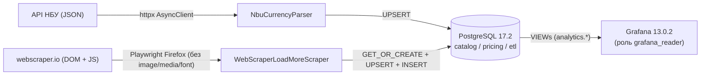
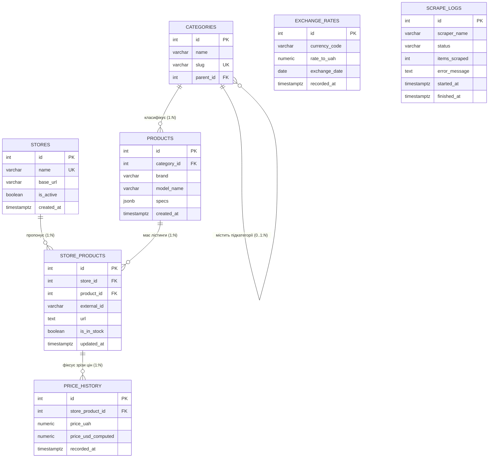
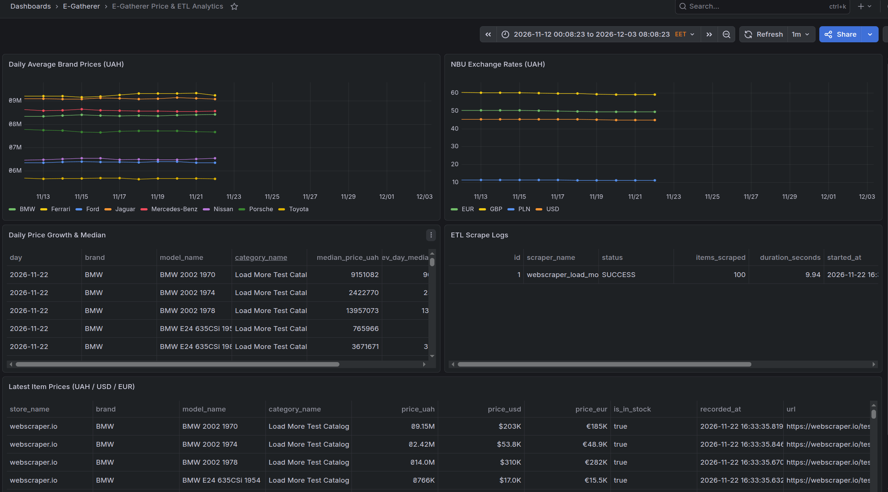
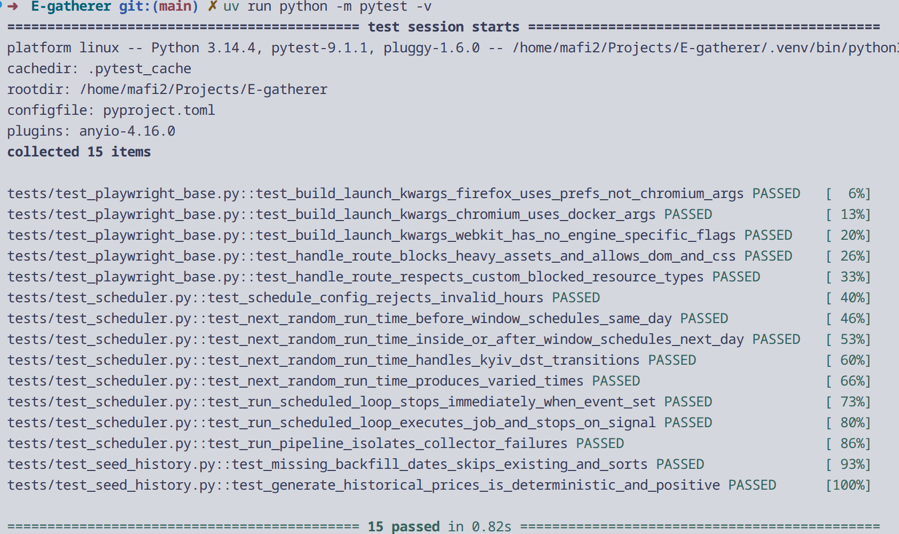

# ПОЯСНЮВАЛЬНА ЗАПИСКА ДО КУРСОВОЇ РОБОТИ

**Дисципліна:** Бази даних  
**Тема:** «Проєктування та реалізація бази даних інформаційної системи автоматизованого збору, зберігання та аналізу даних із вебресурсів»  
**Програмна реалізація:** E-Gatherer (`Python 3.14+`, `PostgreSQL 17.2`, `SQLAlchemy 2.0` + `asyncpg`, `Playwright Firefox/Gecko`, `httpx`, `Grafana 13.0.2`, `Docker Compose`)  
**Дата підготовки звіту:** 23.11.2026  

> **Примітка щодо формату реалізації:** За погодженням із викладачем замість класичного набору автономних SQL-скриптів DDL/DML використано об’єктно-реляційне відображення **SQLAlchemy 2.0** (асинхронний драйвер `asyncpg`, декларативні моделі `src/db/models.py`, транзакційний репозиторій `src/db/repository.py`) у поєднанні з нативними SQL-представленнями PostgreSQL (`src/db/sql_views.py`) та мінімальними скриптами ініціалізації розширень і ролей (`database/01-init.sql`, `database/02-roles.sh`).  
> **Позначення достовірності у звіті:** **FACT** — безпосередньо підтверджено файлами репозиторію, конфігураціями або виконаними тестами/запитами; **INFERENCE** — інженерний висновок на основі перевірених фактів; **ASSUMPTION** — обґрунтоване припущення; **`[не виконувалося / потребує перевірки]`** — експерименти з методичних рекомендацій, протоколи яких відсутні у поточному комплекті.

---

## ЗМІСТ

- [ВСТУП](#вступ)
- [1 АНАЛІЗ ПРЕДМЕТНОЇ ОБЛАСТІ ТА ПОСТАНОВКА ЗАДАЧІ](#1-аналіз-предметної-області-та-постановка-задачі)
  - [1.1 Процеси, користувачі та інформаційні потоки](#11-процеси-користувачі-та-інформаційні-потоки)
  - [1.2 Аналіз наявних рішень](#12-аналіз-наявних-рішень)
  - [1.3 Функціональні, нефункціональні вимоги та бізнес-правила](#13-функціональні-нефункціональні-вимоги-та-бізнес-правила)
  - [1.4 Межі системи та критерії перевірки](#14-межі-системи-та-критерії-перевірки)
- [2 ПРОЄКТУВАННЯ БАЗИ ДАНИХ](#2-проєктування-бази-даних)
  - [2.1 Концептуальна модель](#21-концептуальна-модель)
  - [2.2 Реляційна схема і нормалізація](#22-реляційна-схема-і-нормалізація)
  - [2.3 Вибір СУБД, типів даних, індексів та обмежень](#23-вибір-субд-типів-даних-індексів-та-обмежень)
  - [2.4 Словник даних і модель доступу](#24-словник-даних-і-модель-доступу)
- [3 РЕАЛІЗАЦІЯ БАЗИ ДАНИХ ТА ETL-ПІДСИСТЕМИ](#3-реалізація-бази-даних-та-etl-підсистеми)
  - [3.1 Ініціалізація структури, ORM-моделі та тестове наповнення](#31-ініціалізація-структури-orm-моделі-та-тестове-наповнення)
  - [3.2 ORM-запити та аналітичні представлення](#32-orm-запити-та-аналітичні-представлення)
  - [3.3 Бізнес-логіка на рівні застосунку та вбудовані механізми БД](#33-бізнес-логіка-на-рівні-застосунку-та-вбудовані-механізми-бд)
  - [3.4 Транзакції, ролі, права доступу та інфраструктура Docker і Grafana](#34-транзакції-ролі-права-доступу-та-інфраструктура-docker-і-grafana)
- [4 ПЕРЕВІРКА ТА ДОСЛІДЖЕННЯ РОБОТИ СИСТЕМИ](#4-перевірка-та-дослідження-роботи-системи)
  - [4.1 Функціональні та юніт-перевірки, ізоляція ролей](#41-функціональні-та-юніт-перевірки-ізоляція-ролей)
  - [4.2 Конкурентний доступ та межі транзакцій](#42-конкурентний-доступ-та-межі-транзакцій)
  - [4.3 Аналіз планів виконання та індексів](#43-аналіз-планів-виконання-та-індексів)
  - [4.4 Резервне копіювання і відновлення](#44-резервне-копіювання-і-відновлення)
  - [4.5 Порівняння моделей зберігання та обмеження рішення](#45-порівняння-моделей-зберігання-та-обмеження-рішення)
- [ВИСНОВКИ](#висновки)
- [СПИСОК ВИКОРИСТАНИХ ДЖЕРЕЛ](#список-використаних-джерел)
- [ДОДАТОК А — Повний словник даних і відповідність об’єктів БД методичним вимогам](#додаток-а--повний-словник-даних-і-відповідність-обєктів-бд-методичним-вимогам)
- [ДОДАТОК Б — Інструкція розгортання та відтворення результатів](#додаток-б--інструкція-розгортання-та-команди-відтворення)

---

## ВСТУП

Моніторинг цін в інтернет-магазинах України (насамперед на ринку комп’ютерних комплектуючих — відеокарт GPU та процесорів CPU) і зіставлення товарних позицій між різними постачальниками потребують не разового копіювання сторінок, а системного збереження часових рядів (time-series) із прив’язкою до офіційних валютних курсів. Без реляційної структури, чітких обмежень цілісності та історії змін неможливо об’єктивно оцінити динаміку цін, медіанні значення, кореляцію з курсом долара США, волатильність чи фактичну наявність моделей у магазинах.

**Мета курсової роботи** — спроєктувати та реалізувати надійну, оптимізовану під обмежені серверні ресурси базу даних на базі PostgreSQL 17 і асинхронний ETL-конвеєр **E-Gatherer** для автоматизованого збору, нормалізованого зберігання та аналізу цінових даних із вебресурсів (інтернет-магазинів України та контрольних тестових каталогів) і курсів валют НБУ з візуалізацією у Grafana.

Для досягнення поставленої мети виконано такі завдання:

1. Проаналізовано предметну область, виклики сучасного вебзбору (захист WAF великих агрегаторів на противагу відкритим внутрішнім JSON API магазинів із помірним захистом, рендеринг JS, зіставлення нечітких назв товарів) та сформульовано бізнес-правила і вимоги до системи.
2. Спроєктовано багаторівневу (доменно-розділену) модель даних у PostgreSQL зі схемами `catalog`, `pricing`, `etl`, `analytics`, індексуванням часових рядів (`B-Tree DESC`) і нечіткого текстового пошуку (`GIN` + `pg_trgm`).
3. Реалізовано ORM-моделі та транзакційний шар доступу на базі SQLAlchemy 2.0 + `asyncpg`, а також 7 аналітичних представлень (`VIEW`) для Grafana.
4. Побудовано модульну підсистему збору даних (`httpx` для JSON API НБУ та заготовки API-колектора `brain.py`; headless `Playwright Firefox/Gecko` для динамічних сторінок на відтворюваному тестовому каталозі `https://webscraper.io/test-sites/load-more`), генератор 30-денної історії та щоденний планувальник запуску.
5. Розгорнуто ізольований стек контейнерів (`db`, `scraper`, `grafana`) з урахуванням апаратних лімітів цільового сервера (4 ГБ RAM, 2-ядерний CPU, 5400 RPM HDD) і проведено дослідження швидкодії індексу `pg_trgm` проти `ILIKE`/`LIKE`.

**Об’єкт проєктування:** база даних та інформаційні потоки автоматизованого моніторингу цін і валютних курсів.  
**Предмет проєктування:** реляційна схема, механізми індексації та нечіткого зіставлення (`pg_trgm`), розмежування прав доступу (`etl_worker`, `grafana_reader`), транзакційна взаємодія через SQLAlchemy 2.0 ORM і аналітичні представлення PostgreSQL.

---

## 1 АНАЛІЗ ПРЕДМЕТНОЇ ОБЛАСТІ ТА ПОСТАНОВКА ЗАДАЧІ

### 1.1 Процеси, користувачі та інформаційні потоки

З комерційної та експлуатаційної точки зору система вирішує завдання безперервного цінового аналізу без ручного обходу каталогів:

- **Хто (користувачі та ролі):**
  - *Аналітик / власник системи* — переглядає зведені тренди, медіанні ціни, приріст за день, порівняння в UAH/USD/EUR та стан ETL-задач у Grafana через обмежену роль `grafana_reader` (`SELECT` лише на схему `analytics`).
  - *Автоматизований ETL-воркер (`etl_worker`)* — виконує щоденний збір курсів валют НБУ та товарних позицій із вебджерел, записує сирі зрізи у `pricing.*` і `catalog.*` та фіксує статус у `etl.scrape_logs`.
  - *Адміністратор БД (`postgres`)* — виконує початкову ініціалізацію розширення `pg_trgm`, налаштування ролей та резервне копіювання.
- **Проблема сьогодні:** ручна перевірка прайсів і курсів валют не дає ретроспективної історії; збереження лише останньої або середньої ціни призводить до втрати сирих даних (неможливо перерахувати квантилі чи волатильність заднім числом). Додатково різні магазини по-різному називають той самий товар, що ускладнює зіставлення точним пошуком `LIKE`/`ILIKE`.
- **Цінність рішення:** система зберігає кожен часовий зріз із точним часом `timestamptz` (Single Source of Truth), автоматично конвертує ціни за актуальним курсом НБУ та надає готові аналітичні зрізи в реальному часі без навантаження на вебсервер (FastAPI виключено зі стеку для економії RAM).
- **Експлуатаційні ризики:** зміна HTML-розмітки цільового сайту, блокування IP або WAF, а також вичерпання оперативної пам’яті (Linux OOM Killer) чи деградація дискового I/O на сервері з 4 ГБ RAM та HDD 5400 RPM.

**Основні інформаційні потоки системи** (FACT: реалізовано в `src/main.py`, `src/scheduler.py`, `src/collectors/*`):

1. **Потік 1 — Отримання офіційних курсів валют (`NbuCurrencyParser`):** планувальник (вікно `01:00–04:00 Europe/Kyiv`) або ручний запуск `--once` викликає `NbuCurrencyParser`, який асинхронно через `httpx.AsyncClient` запитує JSON API НБУ (`USD`, `EUR`, `PLN`, `GBP`), відсіює внутрішньоденні довідкові записи (`"довідковий"`) і виконує ідемпотентний `UPSERT` у `pricing.exchange_rates`.
2. **Потік 2 — Вебзбір товарних пропозицій (`WebScraperLoadMoreScraper`):** запускається послідовно *після* валютного парсера (`src/main.py`), щоб отримати найсвіжіший курс USD із БД. Headless Firefox (Playwright) завантажує цільову сторінку (`https://webscraper.io/test-sites/load-more`), блокуючи `image`, `media`, `font` задля економії пам’яті, натискає кнопку дозавантаження (`.load-more-btn.ecommerce-items-scroll-more`) до вичерпання карток, після чого BeautifulSoup екстрагує товарні позиції у незмінні DTO `ScrapedPriceItem`, а `DatabaseRepository` створює/оновлює довідники та додає рядок у `pricing.price_history`.
3. **Потік 3 — Журналювання ETL (`BaseParser.run()`):** успішне завершення фіксується в тій самій транзакції (`status='SUCCESS'`, `items_scraped`), а виняток відкочує робочу транзакцію і створює окрему транзакцію для запису `status='FAILED'` з текстом `error_message` у `etl.scrape_logs`.
4. **Потік 4 — Аналітична візуалізація:** Grafana підключається до PostgreSQL як `grafana_reader` і опитує виключно представлення схеми `analytics`.



*Рисунок 1.1 — Узагальнена схема інформаційних потоків системи E-Gatherer.*

### 1.2 Аналіз наявних рішень

Вибір цільових джерел даних і способу зберігання обґрунтовано з урахуванням стабільності даних для курсового проєкту (FACT: зафіксовано у `todos/PLAN.md` та `todos/method-recomends.md`).

| Критерій порівняння | Готові агрегатори (Hotline, Price.ua) | Самостійний парсинг великих ритейлерів (Rozetka тощо) | Підхід E-Gatherer (відкриті API + помірні UA-магазини + тестові каталоги + PostgreSQL) |
| :--- | :--- | :--- | :--- |
| **Збір і доступність даних** | Закрита модель; агресивний захист WAF (Cloudflare Turnstile, DataDome, Kasada) | Блокування стандартних HTTP-клієнтів за TLS/JA4, HTTP/2 fingerprint, CDP-артефактами та ASN IP | Орієнтація на магазини з менш агресивним захистом (**Telemart**, **Brain**, **ITbox**, **Compx**, **Enko** — часто відкриті внутрішні JSON API у DevTools $\rightarrow$ Network; заготовка `src/collectors/api/brain.py`), відкритий API НБУ (`httpx`) та відтворюваний Playwright-колектор на `webscraper.io/test-sites/load-more` |
| **Пошук і зіставлення назв** | Внутрішні пропрієтарні каталоги без доступу до індексів | Потребує ручного мапінгу або окремого рушія пошуку | Власний GIN-індекс `pg_trgm` у PostgreSQL (`%`, `similarity()`, `word_similarity()`) + `JSONB specs` |
| **Історія змін (time-series)** | Публічно відображається обмежено або без доступу до сирих зрізів | Відсутня без власного збору | Повна сира історія в `pricing.price_history` із конвертацією в USD/EUR |
| **Звітність та аналітика** | Готові кабінети без довільних SQL-агрегацій | Відсутня без власної БД | 7 SQL-представлень (`analytics.*`) + автоконфігурований дашборд Grafana (динаміка цін, кореляція з USD, порівняння магазинів) |
| **Керування доступом** | Зовнішній сервіс, немає контролю на рівні БД | — | Least-privilege ролі PostgreSQL (`etl_worker`, `grafana_reader`) і розділення схем |

*Таблиця 1.1 — Порівняння підходів до автоматизованого збору та аналізу цін.*

**Висновок порівняння:** Для навчальної та прикладної задачі з дисципліни «Бази даних» витрачати 80% часу на боротьбу з WAF агрегаторів на кшталт Rozetka чи Hotline нераціонально; набагато вищу інженерну цінність забезпечує поєднання: (1) українських магазинів із помірним захистом та внутрішніми JSON API (**Telemart**, **Brain**, **ITbox**, **Compx**, **Enko**), (2) відкритого REST/JSON API НБУ, (3) модульного Playwright-колектора на стабільному тестовому сайті `webscraper.io/test-sites/load-more` та (4) резервного seed-генератора історії (`scripts/seed_history.py`).

### 1.3 Функціональні, нефункціональні вимоги та бізнес-правила

Нижче наведено матрицю простежуваності вимог, що безпосередньо відображає фактичну реалізацію в коді проєкту.

| Код | Вимога / Бізнес-правило | Спосіб реалізації в БД / ORM | Спосіб перевірки |
| :--- | :--- | :--- | :--- |
| **BR01** | Усі сирі зрізи цін повинні зберігатися з міткою часу без перезапису попередньої історії | Таблиця `pricing.price_history` (`recorded_at timestamptz`, `record_price()` додає новий запис) | `SELECT COUNT(*)`, перевірка журналу `psql` після `make scrape-save` |
| **BR02** | Внутрішньоденні «довідкові» курси НБУ не повинні перезаписувати офіційний денний курс | Фільтр `"довідковий" in title.lower()` у `NbuCurrencyParser.parse()` + `UNIQUE (currency_code, exchange_date)` | Запуск `make currency` / `make currency-save`, перевірка `pricing.exchange_rates` |
| **BR03** | Повторний збір за ту саму дату для тієї самої валюти оновлює існуючий запис без дублікатів | `upsert_exchange_rate()` із `ON CONFLICT (uq_currency_exchange_date) DO UPDATE` | Повторний виклик `make currency-save` |
| **BR04** | У межах одного магазину товарна позиція однозначно ідентифікується парою `(store_id, external_id)` | `UniqueConstraint("store_id", "external_id", name="uq_store_external_id")` + `upsert_store_product()` | Повторний запуск `make scrape-save` не створює дублів у `catalog.store_products` |
| **BR05** | Кожен товар належить рівно одній категорії; видалення категорії заборонено, якщо існують товари | `ForeignKey("catalog.categories.id", ondelete="RESTRICT")` у `Product.category_id` | Негативний тест видалення використаної категорії |
| **FR01** | Ієрархічна організація категорій довільної вкладеності | Самовказівний FK `categories.parent_id -> categories.id` (`ondelete="SET NULL"`) | Перевірка моделі `Category` в `src/db/models.py` |
| **FR02** | Автоматичний розрахунок денних агрегатів (min, avg, max, median) та добового приросту цін | Представлення `analytics.v_daily_price_aggregates` та `analytics.v_price_growth` (`LAG()`) | Запит до `analytics.*` у `psql` та панелях Grafana |
| **FR03** | Нечіткий пошук і зіставлення назв товарів із толерантністю до опечаток | Розширення `pg_trgm`, індекс `ix_products_model_name_trgm` (`GIN gin_trgm_ops`), `search_products_trgm()` | Бенчмарки `make bench` та `make bench-large` |
| **FR04** | Аудит кожного запуску колектора із фіксацією успіху чи помилки | Таблиця `etl.scrape_logs` + шаблонний метод `BaseParser.run()` | Запит до `etl.scrape_logs` та `analytics.v_scrape_logs` |
| **FR05** | Щоденний автономний запуск у випадковий час нічного вікна `01:00–04:00` за часом Києва | `ScheduleConfig` + `next_random_run_time()` (інтерполяція в UTC для коректності DST) | 8 юніт-тестів у `tests/test_scheduler.py` (PASSED) |
| **NFR01** | Ізоляція прав доступу за принципом найменших привілеїв (least-privilege) | Скрипт `database/02-roles.sh`: `etl_worker` (власник схем) та `grafana_reader` (`SELECT` лише на `analytics`) | Тести доступу через `psql -U grafana_reader` (`database/README.md`) |
| **NFR02** | Робота в умовах сервера: 4 ГБ RAM, 2 ядра CPU, 5400 RPM HDD без OOM та swap-thrashing | Послідовний запуск парсерів, `@dataclass(slots=True, frozen=True)`, блокування `image`/`media`/`font` у Firefox, `pool_size=5`, ліміти пам’яті Docker Compose (`512M` + `1536M` + `256M` = `2304M`) | Юніт-тести `tests/test_playwright_base.py` (5 PASSED), інспекція `docker-compose.yml` |
| **NFR03** | Стійкість конвеєра до збою окремого парсера | Перехоплення винятків у циклі `run_pipeline()` (`src/main.py`) | Тест `test_run_pipeline_isolates_collector_failures` (PASSED) |

*Таблиця 1.2 — Матриця простежуваності вимог та бізнес-правил.*

### 1.4 Межі системи та критерії перевірки

**У межах системи (In-Scope):**

- Асинхронний збір даних із відкритого REST/JSON API НБУ та вебсторінок через модульний інтерфейс `BaseParser` / `BasePlaywrightScraper` (реалізовано колектори `nbu_exchange_rates` і `webscraper_load_more` для `https://webscraper.io/test-sites/load-more`; у `src/collectors/api/brain.py` зафіксовано цільовий URL внутрішнього API магазину Brain: `https://brain.com.ua/api/v1/quick_search/?Search=rtx%204070`, розширення під Telemart / ITbox / Compx / Enko закладається архітектурно).
- Довготривале зберігання часових рядів цін і валют у PostgreSQL 17.2.
- Генератор 30-денної історії (`scripts/seed_history.py`) на базі реальних архівних курсів НБУ та детермінованого дрейфу цін для демонстрації часових графіків.
- Аналітичні представлення (`analytics.*`) та візуалізація у Grafana 13.0.2.

**Поза межами системи (Out-of-Scope):**

- Окремий HTTP-вебсервер/REST API поверх БД (FastAPI навмисно виключено з архітектури для вивільнення оперативної пам’яті на користь Playwright і PostgreSQL).
- Обхід комерційних антибот-систем (CAPTCHA, Turnstile, Kasada, DataDome) чи проксі-мережі.
- Оформлення замовлень, персональні дані користувачів магазинів або фінансові транзакції.

---

## 2 ПРОЄКТУВАННЯ БАЗИ ДАНИХ

### 2.1 Концептуальна модель

Модель даних розбита на три функціональні області зберігання (`catalog`, `pricing`, `etl`) та окрему вітрину аналітичних представлень (`analytics`). У базі даних реалізовано 7 сутностей (`src/db/models.py`):

1. **`catalog.stores`** — довідник відстежуваних інтернет-магазинів.
2. **`catalog.categories`** — ієрархічний довідник категорій товарів із рекурсивним зв’язком `parent_id`.
3. **`catalog.products`** — еталонні (канонічні) товари з брендом, назвою моделі та варіативними технічними характеристиками у `JSONB`.
4. **`catalog.store_products`** — асоціативна сутність (зв’язує магазин та еталонний товар, перетворюючи логічний зв’язок `N:M` між `stores` і `products` на `1:N` + `N:1`, із власними атрибутами `external_id`, `url`, `is_in_stock`, `updated_at`).
5. **`pricing.price_history`** — таблиця фактів часових рядів, що зберігає кожне зафіксоване значення ціни для конкретної пропозиції магазину.
6. **`pricing.exchange_rates`** — довідник щоденних офіційних курсів валют НБУ щодо UAH.
7. **`etl.scrape_logs`** — автономний журнал аудиту запусків колекторів (`SUCCESS`, `FAILED`, `PARTIAL`).



*Рисунок 2.1 — ER-діаграма бази даних E-Gatherer.*

**Пояснення кратності та обов’язковості зв’язків:**

- `stores (1) — (0..N) store_products`: магазин може мати нуль або багато товарних пропозицій; пропозиція обов’язково належить одному магазину (`store_id NOT NULL`).
- `categories (0..1) — (0..N) categories`: коренева категорія має `parent_id IS NULL`; дочірня посилається на батьківську (`ondelete="SET NULL"`).
- `categories (1) — (0..N) products`: кожен еталонний товар обов’язково віднесено до однієї категорії (`category_id NOT NULL`, `ondelete="RESTRICT"`).
- `products (1) — (0..N) store_products`: еталонний товар може продаватися в кількох магазинах; пропозиція завжди прив’язана до еталонного товару (`product_id NOT NULL`).
- `store_products (1) — (0..N) price_history`: одна пропозиція магазину накопичує серію історичних цін; кожен запис історії обов’язково належить одній пропозиції (`store_product_id NOT NULL`).
- `exchange_rates` та `scrape_logs` є незалежними таблицями подій/журналювання, оскільки курси НБУ застосовуються аналітично за датою, а логи фіксують роботу навіть тих колекторів, які не пов’язані з магазинами (наприклад, `nbu_exchange_rates`).

### 2.2 Реляційна схема і нормалізація

Схему спроєктовано з дотриманням **третьої нормальної форми (3НФ)** із контрольованими інженерними компромісами:

1. **Перша нормальна форма (1НФ — атомарність):**
   - Усі скалярні стовпці (`brand`, `model_name`, `price_uah`, `currency_code`, `rate_to_uah`, `external_id`, `url`) містять атомарні значення; повторюваних груп стовпців на кшталт `price_day_1`, `price_day_2` або `store_1_url` немає.
   - *Компроміс:* поле `products.specs` має тип `JSONB`. Для товарів із гетерогенними характеристиками (відеокарта має `vram_gb`, `tdp_w`, а автомобіль чи ноутбук — інший набір параметрів) використання `JSONB` дозволяє уникнути надмірної EAV-моделі (Entity–Attribute–Value) або сотень розріджених `NULL`-стовпців. При цьому ключові для пошуку та групування атрибути (`brand`, `model_name`, `category_id`) винесено у звичайні реляційні стовпці.
2. **Друга нормальна форма (2НФ — повна функціональна залежність від первинного ключа):**
   - Усі 7 таблиць використовують сурогатний простий первинний ключ `id` (`Integer`), тому часткові залежності від складеного ключа відсутні за визначенням.
   - Потенційний зв’язок `N:M` між `stores` і `products` винесено в окрему таблицю `store_products`, де атрибути пропозиції (`external_id`, `url`, `is_in_stock`, `updated_at`) залежать саме від конкретної пари `(store_id, external_id)`, а не від самого товару чи магазину окремо.
3. **Третя нормальна форма (3НФ — відсутність транзитивних залежностей):**
   - Назва магазину та `base_url` зберігаються лише в `catalog.stores`, а не дублюються в `store_products` чи `price_history` (усувається аномалія оновлення URL магазину).
   - Назва і `slug` категорії винесені в `catalog.categories` і не дублюються в `catalog.products` (усувається аномалія видалення/перейменування).
   - Відокремлення `products` (еталонного товару) від `store_products` (лістингу магазину) усуває дублювання `brand`, `model_name`, `specs` при появі того самого товару в кількох магазинах.
   - **Контрольована денормалізація:**
     1. У таблиці `pricing.price_history` поряд із `price_uah` зберігається обчислене поле `price_usd_computed`. *Обґрунтування:* швидка побудова часових графіків у доларах без виконання важкого `JOIN`/`LATERAL` на `exchange_rates` для кожного рядка історії; узгодженість забезпечується при вставці у `DatabaseRepository.record_price()` та альтернативно через актуальний перерахунок у view `analytics.v_latest_item_prices`.
     2. У таблиці `pricing.exchange_rates` код валюти (`currency_code CHAR/VARCHAR(3)`) не винесено в окремий довідник `currencies` (на відміну від пропозиції у `method-recomends.md`), що зменшує кількість `JOIN` для 4 цільових валют (`USD`, `EUR`, `PLN`, `GBP`), хоча в майбутньому при розширенні метаданих валют довідник доцільно додати.

### 2.3 Вибір СУБД, типів даних, індексів та обмежень

**Вибір СУБД:** **PostgreSQL 17.2** (`postgres:17.2-alpine`). Обрано через поєднання суворої ACID-цілісності, підтримки віконних функцій та ordered-set агрегатів (`LAG`, `percentile_cont`), нативного бінарного формату `JSONB`, розширення `pg_trgm` із `GIN`-індексами та мінімального споживання пам’яті в Alpine-образі.

**Вибір типів даних (`src/db/models.py`):**

- `Integer` (`autoincrement=True`) — компактні 4-байтні сурогатні ключі (достатні для обсягів курсової системи, економлять місце в індексах на 5400 RPM HDD порівняно з 16-байтним `UUID`).
- `Numeric(12, 2)` для `price_uah`, `price_usd_computed` і `Numeric(10, 4)` для `rate_to_uah` — фіксована десяткова точність без похибок округлення двійкової плаваючої коми (`float`/`double precision`). У Python відповідає типу `decimal.Decimal`.
- `DateTime(timezone=True)` (`TIMESTAMPTZ`) — однозначне збереження моментів подій у UTC із коректним відображенням у часовому поясі `Europe/Kyiv` в Grafana та Python.
- `JSONB` (`server_default=text("'{}'::jsonb")`) — індексоване зберігання характеристик товару.

**Індекси та обмеження цілісності:**

- **Композитний індекс часових рядів:** `ix_price_history_store_prod_recorded` на `(store_product_id, recorded_at DESC)` — прискорює вибірки останньої ціни товару (`DISTINCT ON`) та хронологічні зрізи без повного сортування.
- **Триграмний індекс нечіткого пошуку:** `ix_products_model_name_trgm` (`USING gin (model_name gin_trgm_ops)`) — прискорює оператори `%`, `ILIKE '%...%'` і нечітке зіставлення назв на великих каталогах.
- **Додаткові B-Tree індекси:** `products.brand`, `products.model_name`, `exchange_rates.currency_code`, `exchange_rates.exchange_date`, `scrape_logs.scraper_name`.
- **Поведінка зовнішніх ключів (`ON DELETE`):**
  - `products.category_id -> categories.id`: `ON DELETE RESTRICT` (забороняє видалення категорії з наявними товарами).
  - `categories.parent_id -> categories.id`: `ON DELETE SET NULL` (при видаленні батьківської категорії підкатегорії стають кореневими, не руйнуючи дерево).
  - `store_products.store_id`, `store_products.product_id`, `price_history.store_product_id`: `ON DELETE CASCADE` (FACT: задано в `models.py`; **важливе зауваження щодо ризику:** для промислової експлуатації зв’язок `price_history.store_product_id` доцільно перевести на `ON DELETE RESTRICT`, щоб випадкове видалення лістингу не знищувало накопичену історію цін — див. п. 4.5).

### 2.4 Словник даних і модель доступу

Схему БД логічно розділено на чотири простори імен PostgreSQL (`database/02-roles.sh`):

- `catalog` — довідники магазинів, категорій, еталонних товарів і лістингів.
- `pricing` — історичні ряди цін і курсів НБУ.
- `etl` — технічний аудит виконання парсерів.
- `analytics` — виключно SQL-представлення (`VIEW`) для споживання інструментами візуалізації.

**Рольова модель доступу (`database/02-roles.sh`):**

| Роль | Призначення | Права на схеми та об’єкти | `search_path` |
| :--- | :--- | :--- | :--- |
| `postgres` | Суперкористувач ініціалізації | Повні права на кластер; запуск `01-init.sql` та `02-roles.sh`, створення розширення `pg_trgm`, заборона `CREATE` у `public` для `PUBLIC` | за замовчуванням |
| `etl_worker` | Сервісний акаунт Python-воркера | Власник (`AUTHORIZATION`) схем `catalog`, `pricing`, `etl`, `analytics`; `CONNECT` на БД; `CREATE`, `SELECT`, `INSERT`, `UPDATE`, `DELETE` на власних таблицях і представленнях | `catalog, pricing, etl, analytics, public` |
| `grafana_reader` | Аналітичний обліковий запис Grafana | `CONNECT` на БД; `USAGE` лише на схему `analytics`; `SELECT` на всі існуючі та майбутні таблиці/представлення у схемі `analytics` (`ALTER DEFAULT PRIVILEGES FOR ROLE etl_worker`). Доступ до `catalog`, `pricing`, `etl` відсутній | `analytics, public` |

*Таблиця 2.1 — Матриця ролей та привілеїв у базі даних.*

*(Повний словник даних усіх 7 таблиць і стовпців наведено в Додатку А.)*

---

## 3 РЕАЛІЗАЦІЯ БАЗИ ДАНИХ ТА ETL-ПІДСИСТЕМИ

### 3.1 Ініціалізація структури, ORM-моделі та тестове наповнення

Порядок розгортання бази даних у чистому середовищі складається з двох рівнів:

1. **Контейнерна ініціалізація PostgreSQL (`database/01-init.sql` та `database/02-roles.sh`):**
   - `01-init.sql` вмикає триграмний модуль: `CREATE EXTENSION IF NOT EXISTS pg_trgm;`.
   - `02-roles.sh` ідемпотентно створює ролі `etl_worker` і `grafana_reader` із паролями зі змінних середовища (без зашитих секретів у репозиторії), відкликає `REVOKE CREATE ON SCHEMA public FROM PUBLIC`, створює 4 схеми під володінням `etl_worker` та налаштовує `ALTER DEFAULT PRIVILEGES` для `grafana_reader`.

2. **Програмний bootstrap через SQLAlchemy 2.0 (`src/db/connection.py` — `init_db()`):**
   При старті `src/main.py` або автономного колектора із прапорцем `--save` від імені `etl_worker` виконується `Base.metadata.create_all` (створює таблиці, обмеження й індекси, якщо їх ще немає) та послідовно запускаються `CREATE OR REPLACE VIEW` зі списку `ANALYTICAL_VIEWS_DDL`.

**Тестове та історичне наповнення (`WebScraperLoadMoreScraper` та `scripts/seed_history.py`):**

- **Реальний вебзбір (`https://webscraper.io/test-sites/load-more`):** під час перевірки (`todos/psql-savings.txt`, `2026-11-23 19:22:12–19:22:27 UTC`) скрапер `webscraper_load_more` завантажив і зберіг **100** позицій класичних автомобілів (наприклад, `Ford GT40 1989`, `Porsche 911 Carrera 1957`, `Mercedes-Benz W123 280E 1955`), а `nbu_exchange_rates` за 0.21 с зберіг **4** офіційні курси НБУ (`USD`, `EUR`, `PLN`, `GBP`).
- **Історичний backfill (`scripts/seed_history.py`):** завантажує **реальні** архівні курси НБУ за останні 30 днів паралельними запитами (`asyncio.Semaphore(4)`) до `https://bank.gov.ua/NBUStatService/v1/statdirectory/exchange?date=YYYYMMDD&json`, після чого для кожного вже зібраного товару генерує відсутні денні точки (випадкове блукання ±2%/день, детерміноване через `seed=42`) із прив’язкою до найближчого курсу USD та записом на `12:00 UTC` (що гарантує однаковий календарний день і в UTC, і в `Europe/Kyiv`).

### 3.2 ORM-запити та аналітичні представлення

Операції запису та читання реалізовані в `src/db/repository.py` через типізований SQLAlchemy 2.0 `AsyncSession`, що покриває ключові патерни маніпулювання даними без ручного конструювання небезпечних SQL-рядків:

- **Ідемпотентний `UPSERT` (`ON CONFLICT DO UPDATE` + `RETURNING`):**
  - `upsert_exchange_rate()` — вставляє або оновлює курс валюти за конфліктом `uq_currency_exchange_date`.
  - `upsert_store_product()` — вставляє або оновлює пропозицію магазину за `uq_store_external_id` і повертає оновлений ORM-об’єкт через `.returning(StoreProduct)`.
- **Пошук або створення довідників (`SELECT` + `INSERT` + `flush()`):** методи `get_or_create_store()`, `get_or_create_category()`, `get_or_create_product()`.
- **Вибірка актуального курсу та останніх цін:**
  - `get_latest_usd_rate()` — `SELECT rate_to_uah ... ORDER BY exchange_date DESC LIMIT 1`.
  - У `scripts/seed_history.py` використано `SELECT DISTINCT ON (store_product_id) ... ORDER BY store_product_id, recorded_at DESC, id DESC` (однозначне впорядкування за часом та `id`).
- **Порівняльний пошук за моделлю:** `search_products_bare_sql()` (`Model.ilike(f"%{query}%")`) та `search_products_trgm()` (`SELECT set_limit(:threshold)` + оператор `%` + сортування за `func.similarity(Product.model_name, query).desc()`).

Для аналітичного рівня в `src/db/sql_views.py` створено **7 SQL-представлень** у схемі `analytics`:

| Представлення (`analytics.*`) | Використані SQL-механізми | Призначення |
| :--- | :--- | :--- |
| `v_daily_price_aggregates` | Багатотабличний `JOIN` (4 таблиці), `MIN`, `AVG`, `MAX`, `percentile_cont(0.5) WITHIN GROUP`, `COUNT(DISTINCT)` | Денна агрегація цін у UAH і USD за товарами, брендами та категоріями |
| `v_price_growth` | Віконна функція `LAG(median_price_uah, 1) OVER (PARTITION BY product_id ORDER BY day)`, `NULLIF` | Відстеження щоденної зміни медіанної ціни у гривнях та відсотках |
| `v_product_match_bare_sql` | Самоз’єднання (`Self-JOIN` з `a.id < b.id`), `LIKE`, `SPLIT_PART`, `LOWER` | Демонстраційне базове зіставлення товарів без триграмного індексу |
| `v_product_match_trgm` | `Self-JOIN`, оператор `%`, `similarity()`, `word_similarity()`, `ORDER BY ... DESC` | Нечітке зіставлення схожих моделей товарів за допомогою `pg_trgm` |
| `v_scrape_logs` | `EXTRACT(EPOCH FROM (finished_at - started_at))` | Моніторинг статусів і тривалості виконання ETL-колекторів |
| `v_exchange_rates` | Проєкція над `pricing.exchange_rates` | Безпечний експорт курсів НБУ до Grafana без доступу до схеми `pricing` |
| `v_latest_item_prices` | `CTE` (`WITH`), `DISTINCT ON`, `FILTER (WHERE ...)`, `CROSS JOIN`, 4-табличний `JOIN` | Актуальні прайси кожного лістингу з перерахунком у USD та EUR за останніми курсами НБУ |

*Таблиця 3.1 — Аналітичні представлення схеми `analytics`.*

### 3.3 Бізнес-логіка на рівні застосунку та вбудовані механізми БД

У поточній версії системи власні користувацькі SQL-функції, збережені процедури (`CALL`) та тригери (`CREATE TRIGGER`) **не створювалися** (FACT: відсутні в `database/01-init.sql`, `src/db/models.py` та `src/db/sql_views.py`). Відповідну бізнес-логіку реалізовано в ORM і Python-шарі, а обчислення в БД спираються на стандартні та модульні функції PostgreSQL:

1. **Контракт ETL і аудит (`src/collectors/base.py`):** абстрактний клас `BaseParser[RawT, ParsedT]` реалізує шаблонний метод `run()`: `fetch() -> parse() -> save() -> log_scrape_event()`. Замість тригера аудиту в БД сам пайплайн гарантує запис результату (`SUCCESS` у тій самій транзакції або `FAILED` в ізольованій транзакції обробки помилок).
2. **Імутабельні DTO зі зменшеним споживанням RAM (`src/collectors/schemas.py`):** класи `ExchangeRateItem` та `ScrapedPriceItem` оформлені як `@dataclass(slots=True, frozen=True)`, що виключає витрати пам’яті на словник `__dict__` у кожного об’єкта та гарантує незмінність даних між етапами `parse()` і `save()`.
3. **Оптимізація браузерного рушія (`src/collectors/websites/playwright_base.py`):** `BasePlaywrightScraper` за замовчуванням запускає headless **Firefox (Gecko)** із `DEFAULT_FIREFOX_PREFS` (вимкнена телеметрія, автооновлення, обмежений кеш у пам’яті `browser.cache.memory.capacity = 32768`) та перехоплювачем маршрутів `_handle_route`, який скасовує завантаження `image`, `media`, `font` без порушення перевірки `is_visible()` (блокування `stylesheet` не увімкнено за замовчуванням).
4. **Функції PostgreSQL, задіяні у запитах та представленнях:** вбудовані агрегатні та віконні функції (`MIN`, `AVG`, `MAX`, `LAG`, `percentile_cont`, `EXTRACT`), а також функції модуля `pg_trgm`: `similarity(text, text)` (`STABLE`), `word_similarity(text, text)` (`STABLE`) та `set_limit(real)` (`VOLATILE` у межах сесії).

### 3.4 Транзакції, ролі, права доступу та інфраструктура Docker і Grafana

**Керування транзакціями та пулом (`src/db/connection.py`):**

- Асинхронний рушій `create_async_engine` налаштований під низький бюджет пам’яті (`pool_size=5`, `max_overflow=5`, `pool_pre_ping=True`, `pool_recycle=1800`, `expire_on_commit=False`).
- Контекстний менеджер `get_session()` відкриває `AsyncSession`, виконує `await session.commit()` при успішному завершенні блоку `with` та автоматично викликає `await session.rollback()` у разі будь-якого винятку. Усі методи `DatabaseRepository` виконують проміжний `flush()` за потреби (отримання `id` нових довідників) без передчасного коміту, тому весь набір товарів одного запуску скрапера та відповідний запис в `etl.scrape_logs` фіксуються атомарно.

**Контейнерний стек (`docker-compose.yml`, `Dockerfile`):**
Стек складається з трьох сервісів в ізольованій мережі `db_network` (bridge):

1. **`db` (`postgres:17.2-alpine`):** `shm_size: 128mb`, ліміти `cpus: "1.0"`, `memory: 512M`, healthcheck `pg_isready`, монтування `01-init.sql` і `02-roles.sh` у режимі `:ro,z` (підтримка SELinux), том `postgres_data`.
2. **`scraper` (`python:3.14.10-slim` + Playwright Firefox):** `shm_size: 1g` (запобігає падінню IPC Firefox у `/dev/shm`), `MOZ_DISABLE_CONTENT_SANDBOX=1`, ліміти `cpus: "1.5"`, `memory: 1536M`, непривілейований користувач `appuser`, залежність `db: service_healthy`, часовий пояс `TZ=Europe/Kyiv`.
3. **`grafana` (`grafana/grafana-oss:13.0.2`):** ліміти `cpus: "0.5"`, `memory: 256M`, вимкнена реєстрація `GF_USERS_ALLOW_SIGN_UP="false"`, автоконфігурація джерела даних (`grafana/config/datasources.yml` із `postgresVersion: 1700` та роллю `${GRAFANA_READER_USER}`) і дашборду `grafana/dashboards/egatherer.json`.

Сумарний жорсткий ліміт пам’яті всіх трьох контейнерів становить **2304 МБ (2,25 ГБ)** із 4096 МБ фізичної RAM, що залишає запас близько 1,75 ГБ під ОС Ubuntu Server 24.04 LTS (~300–400 МБ) та дисковий кеш Linux, мінімізуючи ризик swap-thrashing на 5400 RPM HDD.

**Дашборд Grafana (`egatherer.json`):** містить 5 панелей із автооновленням кожну 1 хв (`Europe/Kyiv`):

1. *Daily Average Brand Prices (UAH)* — часовий ряд середніх денних цін за брендами (`analytics.v_daily_price_aggregates`).
2. *NBU Exchange Rates (UAH)* — динаміка курсів валют НБУ (`analytics.v_exchange_rates`).
3. *Daily Price Growth & Median* — таблиця медіанних цін та добової зміни у % (`analytics.v_price_growth`).
4. *ETL Scrape Logs* — журнал запусків парсерів із тривалістю (`analytics.v_scrape_logs`).
5. *Latest Item Prices (UAH / USD / EUR)* — зведення актуальних цін у трьох валютах (`analytics.v_latest_item_prices`).

На рисунку 3.1 показано фактичний результат роботи дашборду «E-Gatherer Price & ETL Analytics» після збору даних із `webscraper.io` та виконання 30-денного backfill: на графіках відображено криві середніх цін для 8 автомобільних брендів (`BMW`, `Ferrari`, `Ford`, `Jaguar`, `Mercedes-Benz`, `Nissan`, `Porsche`, `Toyota`), курси НБУ (`EUR`, `GBP`, `PLN`, `USD`), таблицю приросту медіанної ціни, запис у `ETL Scrape Logs` (`webscraper_load_more`, `SUCCESS`, `100` позицій за `9.94` с) та зведені актуальні ціни у UAH, USD і EUR.



*Рисунок 3.1 — Результат роботи системи: дашборд «E-Gatherer Price & ETL Analytics» у Grafana 13.0.2.*

---

## 4 ПЕРЕВІРКА ТА ДОСЛІДЖЕННЯ РОБОТИ СИСТЕМИ

### 4.1 Функціональні та юніт-перевірки, ізоляція ролей

1. **Автоматизоване юніт-тестування (`uv run python -m pytest -v`, виконано 23.11.2026 у ході підготовки звіту):**
   - **FACT:** Усі **15 із 15 тестів** пройшли успішно за **0.81 с** (Python 3.14.4, `pytest-9.1.1`):
     - `tests/test_playwright_base.py` (5 тестів `PASSED`): перевірено формування параметрів Firefox (`DEFAULT_FIREFOX_PREFS` без Chromium-прапорців), Chromium (`DEFAULT_CHROMIUM_ARGS`), WebKit, а також блокування `image`, `media`, `font` при збереженні `document`, `script`, `stylesheet`, `xhr`, `fetch` та кастомного порожнього списку блокування.
     - `tests/test_scheduler.py` (8 тестів `PASSED`): перевірено валідацію годин вікна, планування до/після вікна, коректність переходу на літній/зимовий час (`Europe/Kyiv`, 29.03.2026 і 25.10.2026), варіативність часу, зупинку за `asyncio.Event`, виконання задачі за розкладом та ізоляцію збою парсера в `run_pipeline()`.
     - `tests/test_seed_history.py` (2 тести `PASSED`): перевірено фільтрацію та сортування відсутніх дат backfill і детерміновану генерацію позитивних цін із точністю до `0.01`.
    - Логи: 

2. **Інтеграційна перевірка наповнення БД (FACT з `todos/psql-savings.txt`, 23.11.2026):**
   - Зафіксовано виконання `webscraper_load_more` (`status = SUCCESS`, `items_scraped = 100`, `19:22:12`–`19:22:27 UTC`) та `nbu_exchange_rates` (`status = SUCCESS`, `items_scraped = 4`, `0.21 с`).
   - Перевірено коректність 3-табличного `JOIN` (`catalog.products`, `catalog.store_products`, `pricing.price_history`) та роботу представлення `analytics.v_daily_price_aggregates`.
   - *(Примітка: перші рядки у `todos/psql-savings.txt` відображають ранній прототип у схемі `public`, тоді як фінальні вибірки виконані вже на цільовій багатосхемній структурі `catalog`/`pricing`/`etl`/`analytics`.)*
3. **Перевірка ізоляції ролей (`database/README.md`):**
   - Задокументовано тестові команди перевірки від імені `etl_worker` та `grafana_reader` (`SELECT * FROM analytics.v_daily_price_aggregates LIMIT 1;` — дозволено; `SELECT * FROM pricing.price_history LIMIT 1;` — очікувана відмова `permission denied`). Фактичне збережене виведення для `grafana_reader` у текстових логах репозиторію відсутнє (`[потребує збереження протоколу під час демонстрації]`).

### 4.2 Конкурентний доступ та межі транзакцій

- **Архітектура конкурентності (FACT з коду):**
  - В `src/main.py` колектори у щоденному циклі запускаються суворо послідовно (`for parser in active_collectors:`), що виключає внутрішню конкуренцію за одні й ті самі рядки між власними скраперами на 2-ядерному сервері.
  - Операції оновлення довідників (`upsert_exchange_rate`, `upsert_store_product`) використовують нативний PostgreSQL `INSERT ... ON CONFLICT DO UPDATE`, який на рівні рушія є атомарним щодо унікального індексу та захищеним від стану гонитви (race condition) при вставці нового запису.
  - Водночас методи `get_or_create_store()`, `get_or_create_category()`, `get_or_create_product()` використовують патерн `SELECT -> INSERT`, тому при потенційному паралельному запуску двох інстансів воркера одночасне створення нового товару чи магазину під рівнем ізоляції за замовчуванням (`READ COMMITTED`) може вимагати ретраю або `ON CONFLICT`.
- **Протокол двосесійного тесту блокувань (`SELECT ... FOR UPDATE` + `lock_timeout`):** `[не виконувалося / протокол у репозиторії відсутній]`. За потреби під час захисту в двох незалежних сеансах `psql` перевіряється оновлення одного рядка `catalog.store_products` (Сеанс А: `BEGIN; SELECT * FROM catalog.store_products WHERE id = 1 FOR UPDATE;`, Сеанс Б: `BEGIN; SET LOCAL lock_timeout = '2s'; UPDATE catalog.store_products SET is_in_stock = false WHERE id = 1;`).

### 4.3 Аналіз планів виконання та індексів

Дослідження ефективності індексу `GIN (gin_trgm_ops)` проти базового пошуку `ILIKE`/`LIKE` виконано двома скриптами (`scripts/benchmark_trgm.py` та `scripts/benchmark_trgm_large.py`) із використанням `EXPLAIN (ANALYZE, BUFFERS)`. Усі числові значення нижче є **FACT** із зафіксованих вимірів у `README.md`.

**Експеримент 1 — Реальні дані (`94` товари у `catalog.products`, поріг `pg_trgm % >= 0.2`):**

| Тест / Запит | Bare SQL (`ILIKE` / `LIKE`) | `pg_trgm` (`% >= 0.2` / `similarity`) | Хіти (Bare / `pg_trgm`) |
| :--- | :---: | :---: | :---: |
| Пошук `'Mercedes'` (точний) | `0.108 ms` *(20.62 ms клієнт)* | `0.427 ms` *(8.46 ms клієнт)* | `10` / `10` |
| Пошук `'Mercdes'` (опечатка) | `0.154 ms` *(1.91 ms клієнт)* | `0.367 ms` *(3.02 ms клієнт)* | `0` / **`7`** *(score `0.207–0.250`)* |
| Пошук `'Ferari'` (опечатка) | `0.119 ms` *(1.56 ms клієнт)* | `0.426 ms` *(2.88 ms клієнт)* | `0` / **`13`** *(score `0.353`)* |
| Пошук `'Toyta'` (коротка опечатка) | `0.139 ms` *(1.52 ms клієнт)* | `0.327 ms` *(3.65 ms клієнт)* | `0` / `0` |
| View `v_product_match_*` (`LIMIT 50`) | `1.597 ms` *(4.73 ms клієнт, `11` buffers)* | `27.256 ms` *(30.19 ms клієнт, `191` buffers)* | `50` (без сортування) / `50` (топ із `529` пар) |

*Таблиця 4.1 — Результати `EXPLAIN (ANALYZE, BUFFERS)` на 94 рядках `catalog.products`.*

**Аналіз Експерименту 1:** на `94` рядках уся таблиця займає **1 сторінку пам’яті** (`shared hit=1`), тому планувальник PostgreSQL свідомо обирає `Seq Scan` в обох випадках. `ILIKE` швидший на долі мілісекунди через просте посимвольне сканування без побудови триграм і без `Sort`, а `v_product_match_bare_sql` зупиняється на перших 5 рядках через відсутність `ORDER BY`. Натомість `pg_trgm` знаходить товари з опечатками (`Mercdes` — 7, `Ferari` — 13), де `ILIKE` повертає `0`. Для дуже коротких слів з опечаткою (`Toyta`) поріг `0.2` у довгій назві замалий — потрібне зниження порогу або `word_similarity()`.

**Експеримент 2 — Масштабний синтетичний каталог (`100 000` рядків, тимчасові таблиці `bench_bare` з B-Tree та `bench_trgm` з `GIN gin_trgm_ops`, `make bench-large`):**

| Тест / Запит | Bare SQL `ILIKE` (`Seq Scan`) | `pg_trgm` (`Bitmap Index Scan` + `GIN`) | Прискорення | Хіти (Bare / `pg_trgm`) |
| :--- | :---: | :---: | :---: | :---: |
| Пошук `'Mercedes'` (точний) | `12.247 ms` *(стоп на `19 980` рядках)* | **`4.705 ms`** *(20/100)* | **2.6x** | `20` / `20` |
| Пошук `'Mercdes'` (опечатка) | `57.012 ms` *(всі `100 000` рядків)* | **`2.910 ms`** | **19.6x** | `0` / `0` *(при `>= 0.2`)* |
| Пошук `'Ferari'` (опечатка) | `55.077 ms` *(всі `100 000` рядків)* | **`2.918 ms`** | **18.9x** | `0` / **`20`** |
| Пошук `'RTX4070Ti'` (точний) | `11.078 ms` *(стоп на `18 982` рядках)* | **`1.334 ms`** | **8.3x** | `20` / `20` |
| Batch-матчинг (`25` назв × `100 000`) | `1787.541 ms` *(`2.5 млн` перевірок)* | **`136.457 ms`** | **13.1x** | `0` / **`50`** *(з `2500` пар)* |

*Таблиця 4.2 — Результати `EXPLAIN (ANALYZE, BUFFERS)` на 100 000 рядках.*

**Висновок дослідження індексів:** Звичайний індекс `B-Tree` не працює для пошуку підрядка всередині тексту (`ILIKE '%...%'`), що спричиняє повне сканування (`Seq Scan`). При масштабуванні до `100 000` рядків планувальник PostgreSQL перемикається на `Bitmap Index Scan on ix_bench_trgm_gin`, завдяки чому `pg_trgm` працює у **2.6–19.6 раза** швидше на одиночному пошуку та в **13.1 раза** швидше на пакетному зіставленні (і одночасно забезпечує нечітку повноту пошуку). Слід також враховувати, що утримання GIN-індексу створює додаткові витрати на `INSERT`/`UPDATE` у `catalog.products`, однак ця таблиця є довідковою (повільне зростання), на відміну від інтенсивно дописуваної `pricing.price_history`, де використано легкий `B-Tree` індекс `(store_product_id, recorded_at DESC)`.

### 4.4 Резервне копіювання і відновлення

Фактичний протокол виконання `pg_dump` та відновлення в окрему чисту базу `pg_restore` у файлах репозиторію відсутній (`[не виконувалося / потребує перевірки перед захистом]`). З огляду на використання контейнерного тому `postgres_data` у `docker-compose.yml` та власної ініціалізації ролей `etl_worker` і `grafana_reader`, регламентна перевірка має виконуватися за таким сценарієм (уточнити на живій системі під час захисту):

1. Створення бінарного дампу: `docker exec postgres_db pg_dump -U postgres -Fc -d egatherer > backup_egatherer.dump`.
2. Підготовка чистої тестової БД (включно з ролями `etl_worker`, `grafana_reader` і розширенням `pg_trgm` через `01-init.sql` / `02-roles.sh`): `docker exec postgres_db createdb -U postgres egatherer_restore_test`.
3. Відновлення: `pg_restore --exit-on-error --no-owner -U postgres -d egatherer_restore_test`.
4. Верифікація: звірка кількості таблиць (`7`), представлень (`7`), індексів, кількості рядків у `catalog.products`, `pricing.price_history`, `pricing.exchange_rates` та перевірка доступу під `grafana_reader`.

### 4.5 Порівняння моделей зберігання та обмеження рішення

| Критерій | PostgreSQL 17.2 (реляційна + `JSONB` + `pg_trgm`) | MongoDB (документна NoSQL) | Redis (in-memory Key-Value / кеш) |
| :--- | :--- | :--- | :--- |
| **Модель даних** | Нормалізована 3НФ (`stores`, `categories`, `products`, `store_products`, `price_history`) + `JSONB specs` для варіативних характеристик | Колекції JSON/BSON-документів; зручно для довільних specs, але дублювання метаданих магазинів або ручні `$lookup` | Структури в RAM (`HASH`, `ZSET`, `STREAM`); немає реляційних FK чи декларативних обмежень цілісності |
| **Типові операції системи** | Віконні функції (`LAG`), `percentile_cont(0.5)`, `DISTINCT ON`, триграмний пошук `GIN` та миттєва візуалізація через нативний Grafana Postgres plugin | Агрегаційний pipeline (`$group`, `$lookup`); складніші багатотабличні аналітичні зрізи | Отримання останньої ціни/курсу за O(1); непридатний для ретроспективних `GROUP BY` без вивантаження |
| **Узгодженість і транзакції** | Сувора ACID-узгодженість (`FK`, `UNIQUE`, `Numeric`), атомарне збереження цін + `etl.scrape_logs` | Транзакції на кількох документах існують (у replica set), але слабша типізація схеми | Лише базові атомарні команди / Lua; ризик втрати незбережених даних при RDB/AOF налаштуваннях |
| **Вимоги до RAM/HDD (4 ГБ)** | ~300–450 МБ RAM (ліміт контейнера `512M`); стабільне дискове зберігання | Вище споживання RAM кешем WiredTiger та більший обсяг BSON на диску | Усі дані мають вміщуватися в RAM — неприйнятно для багаторічних часових рядів на сервері з 4 ГБ RAM |

*Таблиця 4.3 — Архітектурне порівняння PostgreSQL із нереляційними альтернативами для проєкту E-Gatherer.*

**Виявлені обмеження та рекомендації щодо розвитку рішення (INFERENCE):**

1. **Захист історії цін від каскадного видалення:** у `src/db/models.py` зовнішній ключ `PriceHistory.store_product_id` має `ondelete="CASCADE"`. Рекомендується змінити на `RESTRICT`, щоб видалення лістингу магазину не знищувало накопичений часовий ряд.
2. **Конкурентно-безпечні `get_or_create_*`:** у `DatabaseRepository` заміна `SELECT -> INSERT` на `INSERT ... ON CONFLICT DO NOTHING` (або обробку `IntegrityError`) зробить можливим паралельний запуск кількох колекторів без колізій.
3. **Узгодженість часових зон у Python-записах:** у `repository.py` (`record_price`, `log_scrape_event`) за замовчуванням викликається наївний `datetime.now()`, тоді як `BaseParser.run()` передає `datetime.now(UTC)` (`tz-aware`). Рекомендується уніфікувати виклики у `repository.py` через `datetime.now(UTC)`.
4. **Забезпечення повної відповідності формальним критеріям кафедри (за потреби):** при підготовці фінального пакета до захисту варто зберегти текстові протоколи 2-сесійного тесту блокувань (`FOR UPDATE`), `pg_dump`/`pg_restore` і перевірки `grafana_reader`, а також за вимогою кафедри доповнити БД SQL-процедурою/тригером або довідником `currencies`.

---

## ВИСНОВКИ

У межах курсової роботи спроєктовано та реалізовано базу даних і асинхронну ETL-систему **E-Gatherer** на базі **PostgreSQL 17.2**, **SQLAlchemy 2.0 (`asyncpg`)**, **Playwright (Firefox/Gecko)**, **httpx**, **Grafana 13.0.2** та **Docker Compose**.

Основні результати роботи:

1. **Доменно-розділена архітектура БД:** реалізовано 7 нормалізованих таблиць у трьох схемах (`catalog`, `pricing`, `etl`) та 7 аналітичних представлень у схемі `analytics` (`v_daily_price_aggregates`, `v_price_growth`, `v_product_match_bare_sql`, `v_product_match_trgm`, `v_scrape_logs`, `v_exchange_rates`, `v_latest_item_prices`). Використано точні десяткові типи `Numeric`, часові мітки з часовим поясом `DateTime(timezone=True)`, індекс часових рядів `(store_product_id, recorded_at DESC)` і `GIN (gin_trgm_ops)`.
2. **Безпека та розмежування доступу:** налаштовано ізольовані ролі `etl_worker` (власник даних та ETL) і `grafana_reader` (право `SELECT` виключно на представлення схеми `analytics`) без збереження секретів у коді.
3. **Оптимізація під апаратні обмеження (4 ГБ RAM, 2 ядра CPU, 5400 RPM HDD):** впроваджено послідовний нічний планувальник (`01:00–04:00 Europe/Kyiv` із коректною обробкою DST), імутабельні DTO `@dataclass(slots=True, frozen=True)`, блокування важких ресурсів у headless Firefox (`image`, `media`, `font`) та жорсткі ліміти пам’яті контейнерів (`512M` + `1536M` + `256M` = `2304M`).
4. **Верифікація та експериментальні результати:**
   - Підтверджено реальний збір **100** товарних позицій із тестового ресурсу `https://webscraper.io/test-sites/load-more` та **4** курсів НБУ (`todos/psql-savings.txt`), а також роботу скрипта заповнення 30-денної історії (`scripts/seed_history.py`).
   - Усі **15 юніт-тестів** (`tests/test_playwright_base.py`, `tests/test_scheduler.py`, `tests/test_seed_history.py`) успішно пройдено за `0.81 с`.
   - Експериментальне порівняння `EXPLAIN (ANALYZE, BUFFERS)` довело, що на малих каталогах (`94` рядки, `1` сторінка пам’яті) `ILIKE` швидший через відсутність накладних витрат на побудову триграм, однак `pg_trgm` забезпечує вищу повноту пошуку з опечатками (`7` і `13` збігів проти `0`). На каталозі зі **`100 000` рядків** індекс `GIN (gin_trgm_ops)` перемикає план на `Bitmap Index Scan` і дає прискорення у **2.6–19.6 раза** на одиничних запитах та в **13.1 раза** на пакетному зіставленні (`136.457 ms` проти `1787.541 ms`).

---

## СПИСОК ВИКОРИСТАНИХ ДЖЕРЕЛ

1. PostgreSQL Global Development Group. Documentation: PostgreSQL 17: F.33. `pg_trgm` — support for similarity of text using trigram matching. URL: <https://www.postgresql.org/docs/current/pgtrgm.html> (дата звернення: 23.11.2026).
2. SQLAlchemy — The Database Toolkit for Python : сторінка пакета на PyPI (у проєкті версія `>=2.1.8`). URL: <https://pypi.org/project/SQLAlchemy/> (дата звернення: 23.11.2026).
3. asyncpg — An asyncio PostgreSQL driver : сторінка пакета на PyPI (у проєкті версія `>=0.32.0`). URL: <https://pypi.org/project/asyncpg/> (дата звернення: 23.11.2026).
4. playwright — A high-level API to automate web browsers : сторінка пакета на PyPI (у проєкті версія `>=1.65.1`). URL: <https://pypi.org/project/playwright/> (дата звернення: 23.11.2026).
5. httpx — The next generation HTTP client : сторінка пакета на PyPI (у проєкті версія `>=0.28.1`). URL: <https://pypi.org/project/httpx/> (дата звернення: 23.11.2026).
6. beautifulsoup4 — Screen-scraping library : сторінка пакета на PyPI (у проєкті версія `>=4.15.0`). URL: <https://pypi.org/project/beautifulsoup4/> (дата звернення: 23.11.2026).
7. Freitas W. 10 Best Practices for Writing Maintainable Docker Compose Files. DEV Community. URL: <https://dev.to/wallacefreitas/10-best-practices-for-writing-maintainable-docker-compose-files-4ca2> (дата звернення: 23.11.2026).
8. grafana/grafana-oss (tag `13.0.2`) : сторінка офіційного образу на Docker Hub. URL: <https://hub.docker.com/r/grafana/grafana-oss?tag=13.0.2> (дата звернення: 23.11.2026).
9. postgres (tag `17.2-alpine`) : сторінка офіційного образу PostgreSQL на Docker Hub. URL: <https://hub.docker.com/_/postgres> (дата звернення: 23.11.2026).
10. Національний банк України. Офіційний курс гривні щодо іноземних валют (OpenData REST API `NBUStatService`). URL: <https://bank.gov.ua/NBUStatService/v1/statdirectory/exchange?json> (дата звернення: 23.11.2026).
11. Web Scraper Test Sites — Load More. URL: <https://webscraper.io/test-sites/load-more> (дата звернення: 23.11.2026).
12. Методичні рекомендації до виконання курсової роботи з дисципліни «Бази даних» / КАІ, ФКНТ, каф. інженерії програмного забезпечення, спец. F2. Київ, 2027 (конспект у `todos/method-recomends.md`).
13. Astral. `uv` — Installing `uv` (офіційна документація). URL: <https://docs.astral.sh/uv/getting-started/installation/> (дата звернення: 23.11.2026).
14. Podman Desktop. Installing Podman on Windows (офіційна документація). URL: <https://podman-desktop.io/docs/installation/windows-install> (дата звернення: 23.11.2026).
15. Podman. Installation Instructions (Linux packages: Fedora/RHEL, Ubuntu/Debian). URL: <https://podman.io/docs/installation> (дата звернення: 23.11.2026).

---

## ДОДАТОК А — Повний словник даних і відповідність об’єктів БД методичним вимогам

### А.1 Словник даних таблиць (`src/db/models.py`)

| Схема.Таблиця | Стовпець | Тип PostgreSQL / SQLAlchemy | Обмеження / Індекс | Призначення |
| :--- | :--- | :--- | :--- | :--- |
| `catalog.stores` | `id` | `INTEGER` | `PK`, `autoincrement` | Ідентифікатор магазину |
| `catalog.stores` | `name` | `VARCHAR(100)` | `NOT NULL`, `UNIQUE` | Назва магазину |
| `catalog.stores` | `base_url` | `VARCHAR(255)` | `NOT NULL` | Базовий URL сайту |
| `catalog.stores` | `is_active` | `BOOLEAN` | `NOT NULL`, default `True` | Активність моніторингу |
| `catalog.stores` | `created_at` | `TIMESTAMPTZ` | `NOT NULL`, `server_default=now()` | Дата додавання |
| `catalog.categories` | `id` | `INTEGER` | `PK`, `autoincrement` | Ідентифікатор категорії |
| `catalog.categories` | `name` | `VARCHAR(120)` | `NOT NULL` | Назва категорії |
| `catalog.categories` | `slug` | `VARCHAR(120)` | `NOT NULL`, `UNIQUE` | Унікальний slug |
| `catalog.categories` | `parent_id` | `INTEGER` | `FK -> catalog.categories(id) ON DELETE SET NULL`, `NULL` | Батьківська категорія |
| `catalog.products` | `id` | `INTEGER` | `PK`, `autoincrement` | Ідентифікатор еталонного товару |
| `catalog.products` | `category_id` | `INTEGER` | `FK -> catalog.categories(id) ON DELETE RESTRICT`, `NOT NULL` | Категорія товару |
| `catalog.products` | `brand` | `VARCHAR(80)` | `NOT NULL`, `INDEX` | Бренд/виробник |
| `catalog.products` | `model_name` | `VARCHAR(255)` | `NOT NULL`, `INDEX`, `GIN (gin_trgm_ops)` | Назва моделі для пошуку та `pg_trgm` |
| `catalog.products` | `specs` | `JSONB` | `NOT NULL`, `server_default='{}'::jsonb` | Варіативні характеристики |
| `catalog.products` | `created_at` | `TIMESTAMPTZ` | `NOT NULL`, `server_default=now()` | Дата створення |
| `catalog.store_products` | `id` | `INTEGER` | `PK`, `autoincrement` | Ідентифікатор лістингу |
| `catalog.store_products` | `store_id` | `INTEGER` | `FK -> catalog.stores(id) ON DELETE CASCADE`, `NOT NULL`, `UQ(store_id, external_id)` | Посилання на магазин |
| `catalog.store_products` | `product_id` | `INTEGER` | `FK -> catalog.products(id) ON DELETE CASCADE`, `NOT NULL` | Посилання на еталонний товар |
| `catalog.store_products` | `external_id` | `VARCHAR(150)` | `NOT NULL`, `UQ(store_id, external_id)` | Зовнішній код товару в магазині |
| `catalog.store_products` | `url` | `TEXT` | `NOT NULL` | Пряме посилання на сторінку товару |
| `catalog.store_products` | `is_in_stock` | `BOOLEAN` | `NOT NULL`, default `True` | Ознака наявності |
| `catalog.store_products` | `updated_at` | `TIMESTAMPTZ` | `NOT NULL`, `server_default=now()`, `onupdate=now()` | Час останнього оновлення |
| `pricing.price_history` | `id` | `INTEGER` | `PK`, `autoincrement` | Ідентифікатор зрізу ціни |
| `pricing.price_history` | `store_product_id` | `INTEGER` | `FK -> catalog.store_products(id) ON DELETE CASCADE`, `NOT NULL`, `INDEX(store_product_id, recorded_at DESC)` | Посилання на лістинг |
| `pricing.price_history` | `price_uah` | `NUMERIC(12, 2)` | `NOT NULL` | Ціна в гривнях |
| `pricing.price_history` | `price_usd_computed` | `NUMERIC(12, 2)` | `NULL` | Еквівалент у доларах США |
| `pricing.price_history` | `recorded_at` | `TIMESTAMPTZ` | `NOT NULL`, `server_default=now()`, `INDEX(..., recorded_at DESC)` | Момент фіксації ціни |
| `pricing.exchange_rates` | `id` | `INTEGER` | `PK`, `autoincrement` | Ідентифікатор запису курсу |
| `pricing.exchange_rates` | `currency_code` | `VARCHAR(3)` | `NOT NULL`, `INDEX`, `UQ(currency_code, exchange_date)` | Літерний код валюти (`USD`, `EUR`, `PLN`, `GBP`) |
| `pricing.exchange_rates` | `rate_to_uah` | `NUMERIC(10, 4)` | `NOT NULL` | Офіційний курс НБУ до UAH |
| `pricing.exchange_rates` | `exchange_date` | `DATE` | `NOT NULL`, `INDEX`, `UQ(currency_code, exchange_date)` | Дата курсу НБУ |
| `pricing.exchange_rates` | `recorded_at` | `TIMESTAMPTZ` | `NOT NULL`, `server_default=now()` | Час запису в БД |
| `etl.scrape_logs` | `id` | `INTEGER` | `PK`, `autoincrement` | Ідентифікатор логу запуску |
| `etl.scrape_logs` | `scraper_name` | `VARCHAR(80)` | `NOT NULL`, `INDEX` | Ім’я парсера |
| `etl.scrape_logs` | `status` | `VARCHAR(20)` | `NOT NULL` | Статус (`SUCCESS`, `FAILED`, `PARTIAL`) |
| `etl.scrape_logs` | `items_scraped` | `INTEGER` | `NOT NULL`, default `0` | Кількість збережених записів |
| `etl.scrape_logs` | `error_message` | `TEXT` | `NULL` | Текст помилки при збої |
| `etl.scrape_logs` | `started_at` | `TIMESTAMPTZ` | `NOT NULL` | Початок виконання |
| `etl.scrape_logs` | `finished_at` | `TIMESTAMPTZ` | `NOT NULL`, `server_default=now()` | Завершення виконання |

### А.2 Зведення покриття методичних орієнтирів

| Позиція | Стан у проєкті E-Gatherer | Примітка |
| :--- | :--- | :--- |
| Таблиці | **7** таблиць у 3 схемах | Базові довідники, time-series і ETL-лог покриті; без штучного роздування |
| Представлення (`VIEW`) | **7** представлень у `analytics` | Перевищує мінімум методички (від 2) |
| Ролі та права | **2** прикладні ролі (`etl_worker`, `grafana_reader`) + `postgres` | Реалізовано через `database/02-roles.sh` |
| Операції ORM / SQL | `UPSERT`, `DISTINCT ON`, `JOIN`, `CTE`, `LAG()`, `percentile_cont`, `FILTER`, `pg_trgm` | Погоджена заміна сирих SQL-скриптів на SQLAlchemy 2.0 ORM + `sql_views.py` |
| Юніт-тести | **15/15 PASSED** (`pytest`) | Підтверджено запуском `uv run python -m pytest -v` |
| Аналіз планів (`EXPLAIN`) | Виконано на **94** та **100 000** рядках | Верифіковані метрики у `README.md` (`make bench`, `make bench-large`) |
| Функції / Процедури / Тригери | Власних PL/pgSQL немає | Бізнес-логіка та аудит винесені на рівень ORM/ETL (`BaseParser.run()`) |
| Конкурентний доступ / `pg_restore` | Протоколи не збережені в репозиторії | `[не виконувалося / рекомендовано доповнити перед захистом]` |

---

## ДОДАТОК Б — Інструкція розгортання та команди відтворення

### Б.1 Попередні вимоги (`uv`, `Python 3.14`, `Podman` / `Docker`)

1. **Встановлення `uv` (менеджер пакетів і версій Python від Astral):**
   Офіційний standalone-інсталятор не потребує попередньо встановлених Python або Rust:
   - **macOS / Linux:**

     ```bash
     curl -LsSf https://astral.sh/uv/install.sh | sh
     ```

   - **Windows (PowerShell):**

     ```powershell
     powershell -ExecutionPolicy ByPass -c "irm https://astral.sh/uv/install.ps1 | iex"
     ```

   Після встановлення потрібно відкрити новий термінал (щоб оновився `PATH`), перевірити `uv --version` і встановити цільову версію інтерпретатора Python:

   ```bash
   uv --version
   uv python install 3.14
   ```

2. **Встановлення `Podman` (або `Docker`):**
   `Makefile` автоматично визначає доступний контейнерний рушій (`podman` або `docker` через `CONTAINER_CMD`):
   - **Windows:** встановлення через **Podman Desktop** за офіційною інструкцією: <https://podman-desktop.io/docs/installation/windows-install>.
   - **Linux** (через системний пакетний менеджер за офіційною документацією <https://podman.io/docs/installation>):
     - *Ubuntu / Debian:*

       ```bash
       sudo apt update
       sudo apt install -y podman
       ```

     - *Fedora / RHEL / CentOS Stream:*

       ```bash
       sudo dnf install -y podman
       ```

     - Перевірка встановлення:

       ```bash
       podman --version
       ```

### Б.2 Запуск контейнерного стеку та відтворення даних

Повний запуск контейнерного стеку (`db`, `scraper`, `grafana`) та відтворення даних виконується за допомогою `Makefile`:

1. **Налаштування середовища:** скопіювати `database/.env.example` у `.env` (у корені проєкту та/або `database/.env`) і задати паролі `POSTGRES_PASSWORD`, `ETL_WORKER_PASSWORD`, `GRAFANA_READER_PASSWORD`, `GF_SECURITY_ADMIN_PASSWORD`.
2. **Збірка та запуск контейнерів (`Podman` або `Docker`):**

   ```bash
   make docker-build
   make up
   ```

3. **Одноразовий запуск ETL-циклу та заповнення 30-денної історії:**

   ```bash
   make run-container-once
   make seed-container
   ```

   Після виконання дашборд Grafana доступний за адресою `http://127.0.0.1:3000`.
4. **Локальні команди перевірки (через `uv`):**

   ```bash
   make setup        # Встановлення залежностей і Firefox для Playwright
   make test-verbose # Запуск 15 юніт-тестів
   make currency     # Dry-run API НБУ
   make scrape       # Dry-run Playwright (webscraper.io/test-sites/load-more)
   make bench        # EXPLAIN (ANALYZE, BUFFERS) на таблиці catalog.products
   make bench-large  # EXPLAIN (ANALYZE, BUFFERS) на 100 000 рядків (TEMP-таблиці)
   ```
